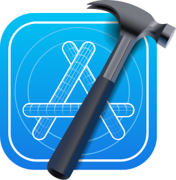

  

<h1 align="center">Germán Orozco </h1>

  <strong>Desarrollador Web Full Stack</strong> · Madrid, España

## 🚀 Sobre mí

Desarrollo aplicaciones web con **React, JavaScript, PHP y MySQL**. Tengo un certificado profesional de nivel 3 en **Desarrollo de Aplicaciones con Tecnologías Web (IFCD0210)** y completé **148 horas de prácticas en Arvikon**, donde trabajé con React y Tailwind CSS en una web adaptable con componentes reutilizables.

También desarrollo aplicaciones Android con **Kotlin** e integro **Firebase** y **APIs REST**. Busco incorporarme a un equipo de desarrollo web donde pueda aportar en frontend y backend y seguir creciendo.

## 📌 Proyectos destacados

| Proyecto | Qué hace |
| --- | --- |
| **Hostelería QR** | Permite consultar la carta y hacer pedidos desde la mesa mediante un código QR. Desarrollado con PHP, arquitectura MVC y MySQL. |
| **Motor Performance** | Aplicación para talleres que reúne las fichas de vehículos, el historial de revisiones y el seguimiento del mantenimiento. |
| **App Android para Hosanna Ministry** | Centraliza anuncios por sede y peticiones de oración, con notificaciones e integración con Firebase. Desarrollada en Kotlin. |

[Ver proyectos en mi portafolio](https://pachinoss.github.io/LandingPage-GO/#portafolio)

## 🛠 Tecnologías

### 🌐 Frontend

### ⚙️ Backend e integraciones

PHP orientado a objetos, MVC y APIs REST.

### 🗃 Bases de datos

### 📱 Desarrollo móvil

### 🔧 Herramientas

## 📫 Contacto

	
	
	
	
	
	
	

